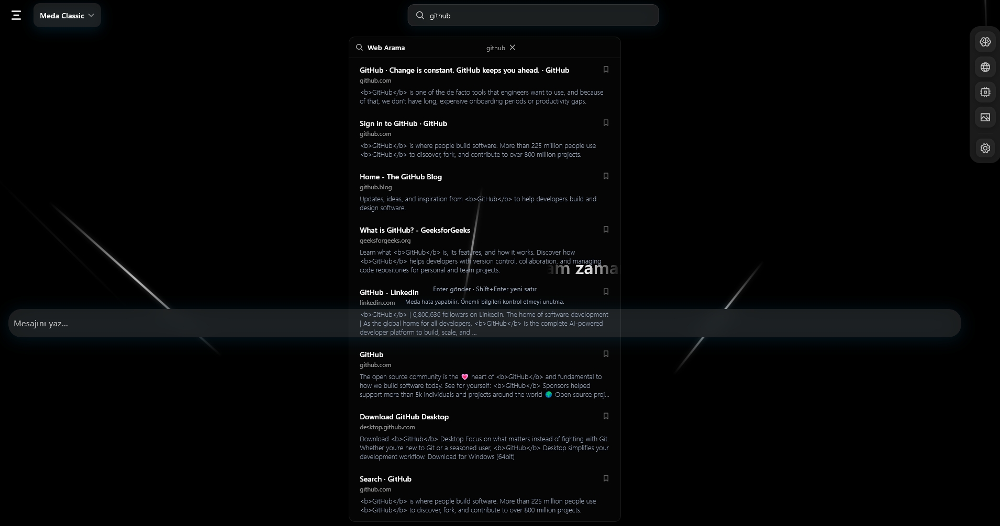
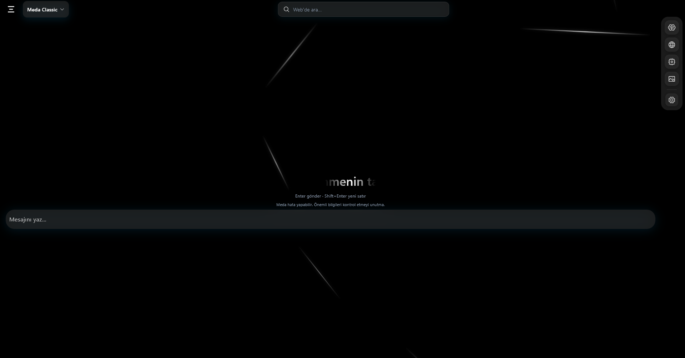

  

<h1 align="center">Meda Public Edition</h1>

  Your local AI assistant. Your desktop. Your conversations.

  Windows • Ollama • Local AI

## About Meda

Meda is a desktop AI assistant designed to bring local AI capabilities to your computer.

Chat, ask questions, explore ideas, generate code and get help with everyday tasks.

## Screenshots

### Meda Chat

### Meda Home

## Features

- AI conversations powered by Ollama.
- Coding and everyday assistance.
- Thinking mode.
- Web search.
- Image and vision capabilities.
- Local backend operation.

## Requirements

- Windows
- Ollama
- A compatible locally installed AI model

## Download

The Windows release will be published in the [Releases](../../releases) section after distribution packaging is finalized.

## Privacy

Meda Public Edition is designed for local operation. Its bundled backend uses localhost by default. Web search requires an internet connection.

## License

Meda is proprietary software.

See [LICENSE](LICENSE) for permitted use and restrictions.

---

## Türkçe

Meda, bilgisayarında yerel yapay zekâ kullanmanı sağlayan bir masaüstü asistanıdır.

- Yapay zekâ ile sohbet et.
- Sorular sor ve fikirlerini geliştir.
- Kod yazma konusunda yardım al.
- Günlük işlerini kolaylaştır.
- Ollama ile yerel modeller kullan.

Windows sürümü hazır olduğunda Releases bölümünde yayımlanacaktır.

**Meda Project © 2026. All rights reserved.**